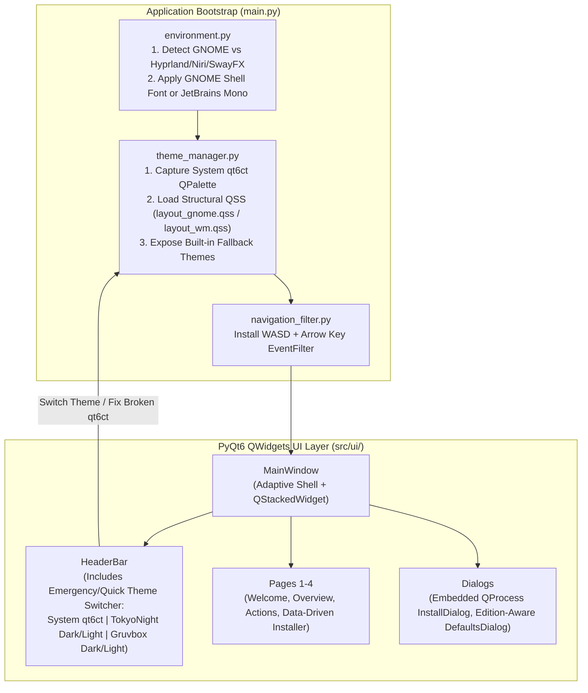
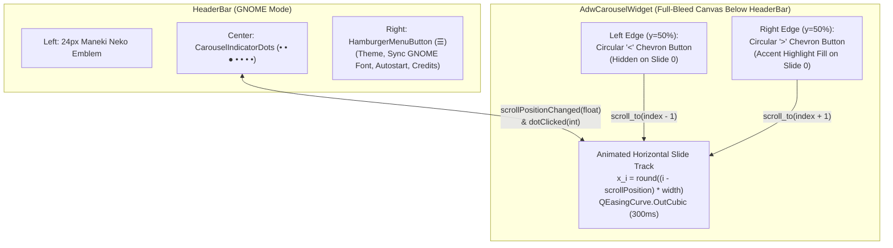

# StratOS Maneki Neko — PyQt5 to PyQt6 Master Porting Plan

> [!IMPORTANT]
> **Goal:** Port [`stratOS-maneki-neko`](file:///home/aadi/stratOS-maneki-neko/main.py) from a monolithic PyQt5 + `.ui` application to a modular, edition-aware **PyQt6 (`QWidgets`)** application in `/home/aadi/stratOS-maneki-neko-qt6`.
> - **Layout & UX:** Replicates a **Libadwaita structural layout on GNOME** and a **keyboard-optimized (`WASD` + Arrow keys) layout on Hyprland, Niri, and SwayFX**.
> - **Theming:** Respects **system-wide `qt6ct` theming** by default (across both GNOME and WM editions), while providing an instant **in-app Theme Switcher** with built-in fallback themes (`tokyonight-dark`, `tokyonight-light`, `gruvbox-dark`, `gruvbox-light`) to guarantee usability even if `qt6ct` is misconfigured.
> - **Typography:** Uses the **GNOME Shell default interface font** when running in GNOME, and **`JetBrains Mono`** in the Window Manager editions.

---

## 1. Audit of the Legacy PyQt5 Codebase

Based on an audit of [`/home/aadi/stratOS-maneki-neko`](file:///home/aadi/stratOS-maneki-neko/README.md), here are the critical bottlenecks and Qt6 breaking points to address during the port:

| Area | Legacy Implementation (`stratOS-maneki-neko`) | Issue / Qt6 Porting Impact |
| :--- | :--- | :--- |
| **Monolithic Entrypoint** | [`main.py`](file:///home/aadi/stratOS-maneki-neko/main.py#L1-L1199) (1,199 lines) | Mixes global state (`AURInstallQueue`, `programInstallQueue`), UI event wiring, and subprocess calls. Instantiates `mainScreen = welcomeScreen()` at import time ([L1182](file:///home/aadi/stratOS-maneki-neko/main.py#L1182)). |
| **Hardcoded QSS Colors Blocking `qt6ct`** | [`welcomeScreen.ui`](file:///home/aadi/stratOS-maneki-neko/src/ui/welcomeScreen.ui#L42-L81) & [`main.py`](file:///home/aadi/stratOS-maneki-neko/main.py#L699-L714) | Hardcodes `background-color: rgb(30, 31, 47); color: rgb(118, 159, 240);` directly on `QMainWindow` and `QWidget`, which completely blocks system-wide `qt6ct` palettes from taking effect. |
| **Hardcoded Fonts** | [`welcomeScreen.ui`](file:///home/aadi/stratOS-maneki-neko/src/ui/welcomeScreen.ui#L243) & [`creditsDialog.ui`](file:///home/aadi/stratOS-maneki-neko/src/ui/creditsDialog.ui#L162) | Hardcodes `font: 24pt "JetBrains Mono"` and `Liberation Mono` inside individual widget stylesheets instead of setting edition-appropriate fonts at the application level. |
| **Hardcoded Working Directory** | `WORK_DIR = os.getcwd()` ([`main.py`](file:///home/aadi/stratOS-maneki-neko/main.py#L186)) | Fails if launched from any directory other than `/opt/maneki-neko` or the repo root. In [`welcomeScreen.ui`](file:///home/aadi/stratOS-maneki-neko/src/ui/welcomeScreen.ui#L39), icon paths hardcode `../../../../../opt/maneki-neko/...`. |
| **Qt Resource Files (`.qrc`)** | [`src/png/main.qrc`](file:///home/aadi/stratOS-maneki-neko/src/png/main.qrc) (`:/switch-on.png`) | **Breaking in PyQt6:** `pyrcc5` was removed in PyQt6. `:/` resource URLs inside QSS will fail unless replaced with `QDir.addSearchPath()` or programmatic custom widgets. |
| **Hardcoded Package UI** | [`welcomeScreen.ui`](file:///home/aadi/stratOS-maneki-neko/src/ui/welcomeScreen.ui) (5,046 lines) & [`updateProgramSRCPreference`](file:///home/aadi/stratOS-maneki-neko/main.py#L261-L366) | Every app's radio buttons (`braveAURButton`, `firefoxFLATPAKButton_4`) and stacked page index (`refDict` in [`main.py`](file:///home/aadi/stratOS-maneki-neko/main.py#L486-L585)) are hardcoded. Adding or removing a package requires editing both Qt Designer XML and 5 Python methods. |
| **GNOME-Hardcoded Settings** | [`changeDefaultsDialog.ui`](file:///home/aadi/stratOS-maneki-neko/src/ui/changeDefaultsDialog.ui#L194-L216) & [`main.py`](file:///home/aadi/stratOS-maneki-neko/main.py#L1133-L1158) | Hardcodes `gnome-control-center` and `gnome-tweaks`, and `depends=('gnome-terminal')` in [`PKGBUILD`](file:///home/aadi/stratOS-maneki-neko/PKGBUILD#L10), which breaks or pulls unwanted GNOME dependencies on Hyprland, Niri, and SwayFX editions. |
| **External Terminal Spawning** | [`invoke_in_terminal`](file:///home/aadi/stratOS-maneki-neko/main.py#L39-L151) & [`DEFAULT_TERMINAL`](file:///home/aadi/stratOS-maneki-neko/main.py#L168) | Reads `$TERM` (which is typically `xterm-256color`, not a binary name), and blocks the Qt event loop with `proc.wait()` ([L123](file:///home/aadi/stratOS-maneki-neko/main.py#L123)), freezing the GUI while the terminal is open. |
| **Unfinished Progress Page** | [`installDialog.ui`](file:///home/aadi/stratOS-maneki-neko/src/ui/installDialog.ui#L472-L579) | Contains a second stacked page (`installProgressPage`) with 4 progress bars that were never wired up to [`package_installer.py`](file:///home/aadi/stratOS-maneki-neko/src/scripts/installscripts/package_installer.py). |

---

## 2. Target Architecture & Directory Structure

### Why Decoupling UI from Backend Won't Cause `PKGBUILD` Issues
Currently, [`PKGBUILD`](file:///home/aadi/stratOS-maneki-neko/PKGBUILD#L22-L23) only runs `install -D -m755 ./main.py $pkgdir/usr/local/bin/$pkgname`, which forgets to copy `src/` entirely.
When we organize the codebase under `/opt/maneki-neko` (with a symlink `/usr/bin/maneki-neko -> /opt/maneki-neko/main.py`), Python automatically adds `/opt/maneki-neko` to `sys.path[0]`. Every submodule (`from src.core... import ...`) resolves natively with **zero extra build dependencies**.

```text
/home/aadi/stratOS-maneki-neko-qt6/
├── main.py                          # Lightweight entry point (~45 lines)
├── PKGBUILD                         # Updated Arch Linux package script (Qt6 + edition-agnostic)
├── maneki-neko.desktop              # Desktop entry template
├── data/
│   ├── packages.json                # Enriched package catalog (metadata, icons, sources, defaults)
│   ├── contributors.json            # Contributors data (replaces hardcoded QTableWidget XML)
│   └── themes.json                  # Built-in color palettes (tokyonight-dark/light, gruvbox-dark/light)
├── assets/
│   ├── icons/                       # App & UI icons (registered via QDir.addSearchPath)
│   ├── images/                      # Banner, Bedrock logo, Maneki Neko mascot
│   └── styles/
│       ├── layout_gnome.qss         # Libadwaita structural QSS (uses palette() roles, not hardcoded colors)
│       └── layout_wm.qss            # Tiling WM structural QSS (uses palette() roles + crisp focus rings)
└── src/
    ├── __init__.py
    ├── core/
    │   ├── paths.py                 # Pathlib-based asset & script resolver (no os.getcwd() bugs)
    │   ├── environment.py           # Detects GNOME vs Hyprland/Niri/SwayFX & resolves edition font
    │   ├── theme_manager.py         # Bridges qt6ct system QPalette + built-in fallback themes
    │   ├── autostart.py             # Manages ~/.config/autostart/maneki_neko.desktop
    │   ├── defaults_manager.py      # xdg-mime / edition-specific settings & theme launchers
    │   └── installer_worker.py      # QProcess runner for package_installer & bedrock strata
    ├── ui/
    │   ├── main_window.py           # Adaptive shell (HeaderBar + Theme Switcher + Pages + Footer)
    │   ├── navigation_filter.py     # Global WASD + Arrow Keys + Enter/Esc eventFilter
    │   ├── components/
    │   │   ├── adw_card.py          # Libadwaita ActionRow / PreferencesGroup style QFrame
    │   │   ├── toggle_switch.py     # Custom QPainter animated pill switch (uses active QPalette)
    │   │   └── header_bar.py        # Top bar with step indicator + persistent Theme Switcher pill
    │   ├── pages/
    │   │   ├── welcome_page.py      # Page 1: Hero welcome + Autostart toggle + Community links
    │   │   ├── overview_page.py     # Page 2: Bedrock/StratOS concepts + Edition quick-guide
    │   │   ├── actions_page.py      # Page 3: Install Strata, Change Defaults, Install Apps
    │   │   └── installer_page.py    # Page 4: Data-driven category tabs + app cards + source selector
    │   └── dialogs/
    │       ├── install_dialog.py    # Confirmation + Embedded QProcess Progress & collapsible log view
    │       ├── defaults_dialog.py   # Edition-aware Default Apps & Theme configuration
    │       └── credits_dialog.py    # Contributors list & Bedrock attribution
    └── scripts/
        └── installscripts/          # Existing bash/python helper scripts (cleaned up for QProcess)
```



---

## 3. Theming, `qt6ct` Integration & Typography Architecture

### 3.1 How System-Wide `qt6ct` + Built-in Fallback Themes Work Together
A common pitfall in Qt apps is writing QSS with hardcoded colors (`background-color: #1e1f2f;`), which completely overrides `qt6ct`. Conversely, relying *only* on `qt6ct` means a misconfigured `qt6ct.conf` (e.g., black-on-black text or missing stylesheet) makes the welcome app unreadable.

`src/core/theme_manager.py` solves both problems cleanly:

1. **Startup Capture & Direct `qt6ct.conf` Color-Only Extraction:**
   - Instead of letting the `qt6ct` platform plugin overwrite fonts or inject broken custom stylesheets, `theme_manager.py` parses `~/.config/qt6ct/qt6ct.conf` directly via Python's `configparser`:
     - Reads `[Appearance] -> color_scheme_path` (e.g., `~/.config/qt6ct/colors/<scheme>.conf` or `/usr/share/qt6ct/colors/<scheme>.conf`).
     - Parses `[ColorScheme] -> active_colors`, `inactive_colors`, and `disabled_colors` (the 20–21 hex values corresponding to Qt's `QPalette.ColorRole` indices `WindowText` through `PlaceholderText`) into a pure `QtGui.QPalette`.
     - Falls back to the startup `QApplication.palette()` if `color_scheme_path` is not set.
   - This extracts **100% of the user's `qt6ct` color scheme** while completely ignoring `[Fonts]` (`general=...`, `fixed=...`) in `qt6ct.conf`!
2. **Color-Agnostic Structural QSS (`layout_gnome.qss` & `layout_wm.qss`):**
   - Because StratOS themes GNOME Shell with the same color scheme as the system-wide Qt theme, the GNOME layout does **not** hardcode GNOME's upstream Adwaita grey colors.
   - Instead, both `layout_gnome.qss` (Libadwaita-style rounded card groups, generous padding, subtle separators) and `layout_wm.qss` (crisp borders, compact tiling margins, high-visibility focus rings) use **Qt `palette()` references** for all colors:
     ```css
     QMainWindow, QDialog {
         background-color: palette(window);
         color: palette(window-text);
     }
     QFrame#AdwCard {
         background-color: palette(base);
         border: 1px solid palette(mid);
         border-radius: 12px; /* 6px in layout_wm.qss */
     }
     QPushButton:focus, QFrame#AdwCard:focus {
         border: 2px solid palette(highlight);
     }
     ```
3. **Built-in Fallback Themes (`data/themes.json`):**
   - Ships with 5 selectable options in the HeaderBar's Theme Switcher (`QComboBox` / menu pill) and via `--theme <name>` CLI flag:
     1. **`System (qt6ct)` (Default):** Restores `SYSTEM_PALETTE` so the app natively matches whatever `qt6ct` color scheme the user or StratOS edition configured.
     2. **`TokyoNight Dark` (`tokyonight-dark`):** Bg `#1a1b26`, Card `#24283b`, Text `#c0caf5`, Accent `#7aa2f7`.
     3. **`TokyoNight Light` (`tokyonight-light`):** Bg `#d5d6db`, Card `#e1e2e7`, Text `#343b58`, Accent `#34548a`.
     4. **`Gruvbox Dark` (`gruvbox-dark`):** Bg `#282828`, Card `#3c3836`, Text `#ebdbb2`, Accent `#fe8019` / `#83a598`.
     5. **`Gruvbox Light` (`gruvbox-light`):** Bg `#fbf1c7`, Card `#ebdbb2`, Text `#3c3836`, Accent `#d65d0e` / `#458588`.
   - When the user picks a built-in theme, `theme_manager.py` constructs a `QtGui.QPalette` from `data/themes.json` and calls `app.setPalette(custom_palette)` + re-polishes the structural QSS.
4. **Misconfigured `qt6ct` Rescue Safeguards:**
   - **Auto-Contrast Sanity Check:** On startup in `System (qt6ct)` mode, `theme_manager.py` computes the luminance contrast ratio between `palette(window)` and `palette(window-text)`. If they are nearly identical (e.g., contrast ratio < 1.8 due to a broken `qt6ct` config), the app logs a warning, automatically falls back to `tokyonight-dark`, and shows a non-intrusive banner: *"Misconfigured system qt6ct palette detected — switched to built-in TokyoNight Dark theme (changeable in top bar)."*
   - **Always-Visible Theme Switcher + Hotkey (`Ctrl+T`):** The top-right HeaderBar always displays a high-contrast `🎨 Theme` selector button (and supports pressing `Ctrl+T` to cycle themes at any time, even without a mouse).

---

### 3.2 Dynamic GNOME Font Tracking vs. WM Font Selector (`JetBrains Mono` / `qt6ct`)

#### Goal
- **On a clean StratOS GNOME build:** GNOME's default font is **`Cantarell`** (with Bold weights for headers/controls), so the app uses `Cantarell`.
- **If the user changes the GNOME font (e.g., to `Rubik` via GNOME Tweaks):** The app automatically detects and uses **`Rubik`** on GNOME (while still ignoring `qt6ct`'s font so `qt6ct` only supplies the color palette).
- **On Window Manager Editions (Hyprland, Niri, SwayFX):**
  - By default on StratOS WM editions, both the app and `qt6ct` use **`JetBrains Mono`**.
  - However, WM users are given an in-app **Font Mode choice**:
    1. **`jetbrains-mono` (Default):** Forces `JetBrains Mono` (10pt) regardless of what is in `qt6ct.conf`.
    2. **`qt6ct-system`:** Reads and applies the system theme font configured under `[Fonts] -> general` in `~/.config/qt6ct/qt6ct.conf` (falling back to `JetBrains Mono` if unset).

#### Why `qt6ct` Normally Conflicts & How We Solve It
When `QT_QPA_PLATFORMTHEME=qt6ct` is active, `libqt6ct.so` hooks into `QPlatformTheme::font()` and reads `[Fonts]` from `~/.config/qt6ct/qt6ct.conf`. If a QSS stylesheet does not explicitly specify `font-family`, Qt's `QStyleSheetStyle` queries `QPlatformTheme::font()` from `qt6ct` instead of `QApplication.setFont()`.

In Qt6's font cascade, **Application Stylesheet (`app.setStyleSheet`) always beats `qt6ct` (`QPlatformTheme`)**:
$$\text{Widget QSS} > \text{Application QSS} > \text{QWidget.setFont()} > \text{QApplication.setFont()} > \text{qt6ct } (\text{QPlatformTheme::font()})$$

We therefore combine **Edition-Specific Font Resolution** with **Runtime `{{FONT_FAMILY}}` QSS Template Injection**:

1. **Step 1 — Resolve the Active Font (`src/core/environment.py`):**
   - **On GNOME (`ui_mode == "gnome"`):**
     - Queries `gsettings get org.gnome.desktop.interface font-name` (cached in `settings.json` for instant startup and refreshed asynchronously).
     - On a clean StratOS GNOME installation, this resolves to **`Cantarell`** (11pt).
     - If the user changes their GNOME font to **`Rubik`** (e.g., `'Rubik 11'`), `query_gnome_interface_font()` parses `"Rubik"` and `11`.
     - `qt6ct`'s font is never used on GNOME—only `qt6ct`'s color palette is loaded.
   - **On Window Manager Editions (`Hyprland`, `niri`, `sway` / SwayFX):**
     - Checks the user's saved `wm_font_mode` preference in `~/.config/maneki-neko/settings.json`:
       - If `"jetbrains-mono"` (default): resolves to **`JetBrains Mono`** (10pt).
       - If `"qt6ct-system"`: parses `[Fonts] -> general` from `~/.config/qt6ct/qt6ct.conf` (which defaults to `JetBrains Mono` on clean StratOS WM builds, or uses the user's custom `qt6ct` font).
2. **Step 2 — Runtime `{{FONT_FAMILY}}` Template Injection into QSS (`src/core/theme_manager.py`):**
   - Both `layout_gnome.qss` and `layout_wm.qss` use a `{{FONT_FAMILY}}` template token at the root `*` selector:
     ```css
     /* layout_gnome.qss — Dynamically populated with GNOME's active font (Cantarell by default, or Rubik if changed) */
     * {
         font-family: "{{FONT_FAMILY}}", "Cantarell", sans-serif;
     }
     QLabel#HeaderTitle, QLabel#SectionTitle, QPushButton {
         font-family: "{{FONT_FAMILY}}", "Cantarell", sans-serif;
         font-weight: bold;
     }
     QPlainTextEdit#TerminalLogView {
         font-family: "JetBrains Mono", monospace;
         font-weight: normal;
     }
     ```
     ```css
     /* layout_wm.qss — Populated with "JetBrains Mono" (default) or the user's qt6ct font when wm_font_mode == "qt6ct-system" */
     * {
         font-family: "{{FONT_FAMILY}}", "JetBrains Mono", monospace;
     }
     ```
   - When `ThemeManager._apply_structural_stylesheet()` loads the `.qss` file, it substitutes `{{FONT_FAMILY}}` with the active font family before calling `app.setStyleSheet(...)`.
3. **Step 3 — Live Font Refresh (`refresh_edition_font()`):**
   - If a GNOME user changes their font in GNOME Tweaks, or a WM user toggles between `JetBrains Mono (Default)` and `System (qt6ct)` font in the UI (or edits `qt6ct`), `ThemeManager` re-renders `{{FONT_FAMILY}}` in the stylesheet immediately!

---

### 3.3 Persistent User Preferences Config (`~/.config/maneki-neko/settings.json`)
To ensure **instant launch times** and provide a single source of truth across all modules (`theme_manager.py`, `environment.py`, `installer_page.py`), Maneki Neko stores user preferences and cached environment state in `~/.config/maneki-neko/settings.json`:

```json
{
  "theme": "system",
  "wm_font_mode": "jetbrains-mono",
  "cached_gnome_font": {
    "family": "Cantarell",
    "size": 11
  },
  "cached_qt6ct_font": {
    "family": "JetBrains Mono",
    "size": 10
  },
  "install_flatpaks_system_wide": true,
  "package_source_preferences": {
    "librewolf": "aur",
    "vlc": "pacman",
    "onlyoffice": "flatpak"
  }
}
```
- **Fast Startup Path:** On launch, Maneki Neko immediately reads `settings.json` (< 1 ms) to apply the user's preferred `theme` (`system` vs `tokyonight-*` / `gruvbox-*`), `wm_font_mode` (`jetbrains-mono` vs `qt6ct-system`), and cached font family without blocking the initial window paint on external subprocesses (`gsettings`), then verifies `gsettings` / `qt6ct.conf` in the background.

---

## 4. Adaptive UX: GNOME Tour Carousel vs. Tiling WMs (Hyprland / Niri / SwayFX)

### 4.1 Layout & Geometry Differences

| Feature | GNOME Edition (`ui_mode == "gnome"`) | Tiling WM Editions (`ui_mode == "wm"`) |
| :--- | :--- | :--- |
| **UI Layout Metaphor** | **GNOME Tour (`AdwCarousel` + `AdwCarouselIndicatorDots`)**: Full-window horizontal animated slide carousel with pagination dots in the `HeaderBar`, floating circular `<` / `>` overlay buttons on the left/right edges, and no bottom footer bar. | **Keyboard-Driven Tiling App**: 4-step `HeaderStepButton` pills in `HeaderBar`, full-width responsive cards (`6px` radius), explicit `2px` focus rings on active card, bottom status bar showing keybind hints (`[WASD/Arrows] Navigate` • `[Space] Toggle` • `[Enter] Continue` • `[Ctrl+T] Theme`). |
| **Window Sizing** | Comfortable floating default (`920x660`), minimum `760x540`. | Tiling-friendly minimum (`600x450`) and **no maximum size cap** (fixes the [`1040x920` maximumSize bug](file:///home/aadi/stratOS-maneki-neko/src/ui/welcomeScreen.ui#L19-L24) that breaks tiling in Niri/Hyprland). |
| **Font** | GNOME's active `gsettings` font (**`Cantarell`** by default on clean StratOS, or e.g. **`Rubik`** if changed by user), injected via `{{FONT_FAMILY}}` in QSS above `qt6ct`. | User-selectable between **`JetBrains Mono` (Default)** and **`System (qt6ct Font)`** (`[Fonts] -> general` in `qt6ct.conf`, which also defaults to `JetBrains Mono` on StratOS WMs). |

---

### 4.2 GNOME Tour Carousel Architecture (`src/ui/components/adw_carousel.py`)

When running in the GNOME Edition (`ui_mode == "gnome"`), Maneki Neko replicates the official **GNOME Tour (`gnome-tour`)** visual layout and smooth horizontal slide physics:



#### 1. `CarouselIndicatorDots` in the `HeaderBar` (`AdwCarouselIndicatorDots` Equivalent)
- Replaces the text step buttons in the center of `HeaderBar` when `ui_mode == "gnome"`.
- Custom `QPainter` widget that renders `N` circular pagination dots horizontally centered in the `HeaderBar`.
- Driven continuously by the carousel's `scrollPosition: float` property:
  - For each dot `i`, proximity is computed as $p_i = \max(0.0, 1.0 - |i - \text{scrollPosition}|)$.
  - **Radius interpolation:** Smoothly scales between `3.0px` (`6px` diameter when inactive) and `4.5px` (`9px` diameter when active).
  - **Color/Opacity interpolation:** Smoothly blends between `35%` alpha `WindowText` (inactive) and `100%` alpha `WindowText` / `Highlight` (active).
- Clicking any dot triggers `carousel.scroll_to(i, animated=True)`.

#### 2. `AdwCarouselWidget` with Smooth Horizontal Slide Physics
- Standard `QStackedWidget` cannot render two pages side-by-side during a transition. `AdwCarouselWidget` is a custom container widget managing a list of slide widgets with a continuous `QtCore.pyqtProperty(float)` named **`scrollPosition`**:
  - **Side-by-Side Sliding Geometry:** During any frame where `scrollPosition` is $s \in [0, N-1]$, each slide $i$ is sized to `(viewport.width(), viewport.height())` and positioned at:
    $$x_i = \text{round}\big((i - s) \times \text{viewport.width()}\big), \quad y_i = 0$$
  - **Zero Idle Overhead:** Only slides whose horizontal bounds $[x_i, x_i + W)$ intersect $[0, W)$ are set `visible = True` during the animation; all off-screen slides remain hidden.
  - **Mid-Flight Interruption & Easing:** Uses `QtCore.QPropertyAnimation(self, b"scrollPosition")` with `QEasingCurve.Type.OutCubic` (`280–320ms`). Triggering another slide change while an animation is already running starts smoothly from the current fractional `scrollPosition` without snapping.
  - **Supported Navigation Inputs:**
    - Floating `<` and `>` circular chevron buttons.
    - Clicking a dot in `CarouselIndicatorDots`.
    - Keyboard `A` / `D` or `Left` / `Right` Arrow keys (via `NavigationFilter`).
    - Touchpad 2-finger horizontal swipe / horizontal scroll wheel (`QWheelEvent`).

#### 3. Floating Circular `<` and `>` Overlay Buttons (`CarouselNavButton`)
- Custom `QPainter` circular buttons (`40x40px`) anchored vertically centered (`y = height // 2 - 20`) at `22px` from the left and right edges of `AdwCarouselWidget`:
  - **On Slide 0 ("Let's Begin" / Welcome Hero):**
    - The left `<` button is **hidden**.
    - The right `>` button is styled as a **prominent accent circle** (`QPalette.ColorRole.Highlight` fill with crisp `HighlightedText` chevron `>`), replicating the exact call-to-action button on Slide 1 of GNOME Tour.
  - **On Intermediate Slides (`1 .. N-2`):**
    - Both `<` and `>` buttons are visible, rendered as subtle circular pills (`QPalette.ColorRole.Button` / `AlternateBase` fill with a `1px` `Mid` border, brightening on hover).
  - **On Final Slide (`N-1`, Curated Software Installer):**
    - The left `<` button remains visible; the right `>` button hides so focus goes to the **"Install Selected (N)"** primary action pill.

#### 4. The 7 GNOME Tour Slides (`src/ui/pages/gnome_tour_slides.py`)
In GNOME mode, the wizard is presented as a cohesive 7-slide visual tour (with no bottom `FooterBar` clutter):
1. **Slide 0 — Welcome ("Let's Begin"):**
   - Centered high-DPI StratOS / Maneki Neko hero illustration (`~400x240px`), bold `22pt` heading **"Welcome to StratOS Linux"**, muted 2-line subtitle *"Learn about the key features in StratOS Linux (GNOME Edition) and set up your system."*, and a compact row of subtle pill buttons for Quick Links (*Documentation*, *GitHub*, *Discord*, *Credits*).
2. **Slide 1 — Multi-Strata Architecture:**
   - Centered hero artwork (`both apt and pacman.png`), bold `20pt` title **"Multi-Strata Architecture"**, and 2-line caption *"Combine Arch Linux, Fedora, and Ubuntu packages seamlessly on one system powered by Bedrock Linux."*
3. **Slide 2 — Unified Package & Stratum Tooling:**
   - Centered hero artwork (`package manager.png`), bold `20pt` title **"Fetch Strata on Demand"**, and 2-line caption *"Need a package from Ubuntu or Fedora? Fetch its stratum in one click and use apt, dnf, or pacman transparently."*
4. **Slide 3 — Tailored Desktop Experience:**
   - Centered hero artwork (`desktop setup.png`), bold `20pt` title **"Cohesive Desktop Experience"**, and 2-line caption *"Automatically syncs with your GNOME Shell font and system-wide qt6ct color palette."*
5. **Slide 4 — Ready-to-Code Developer Tools:**
   - Centered hero artwork (`neovim config.png`), bold `20pt` title **"StratVIM & Stratmacs"**, and 2-line caption *"Jump straight into development with pre-configured Neovim and Emacs distributions."*
6. **Slide 5 — System Setup & Strata Management (`SetupPage`):**
   - Hosted inside the carousel with `76px` left/right horizontal margins (so the floating `<` and `>` circular buttons sit cleanly in the gutters outside the `AdwPreferencesGroup` cards).
7. **Slide 6 — Curated Software Installer (`PackagesPage`):**
   - Hosted inside the carousel with `76px` left/right horizontal margins, search/category filter bar, package cards, and a centered bottom **"Install Selected (N)"** primary pill button.

---

### 4.3 Keyboard Navigation (`WASD` + Arrow Keys)
Implemented in `src/ui/navigation_filter.py` (~60 lines) via an application-wide `QObject.eventFilter`:
- **Bypassed** only when focus is inside a text input widget (`QLineEdit`, `QPlainTextEdit`).
- **`W` / `Up Arrow`**: Focus previous interactive card or button (`focusPreviousChild()`).
- **`S` / `Down Arrow`**: Focus next interactive card or button (`focusNextChild()`).
- **`A` / `Left Arrow`**: Switch to previous category in Package Installer (or cycle package source `Pacman` ↔ `Flatpak` ↔ `AUR` when focused on a package card).
- **`D` / `Right Arrow`**: Switch to next category in Package Installer (or cycle package source).
- **`Space`**: Toggle the checkbox/switch on the focused package card or autostart row.
- **`Enter` / `Return`**: Trigger primary action (`Next` / `Install`).
- **`Escape` / `Backspace`**: Go back one page or close the current dialog.
- **`Ctrl+T`**: Cycle through `System (qt6ct)` → `tokyonight-dark` → `tokyonight-light` → `gruvbox-dark` → `gruvbox-light`.

### 4.4 Unified `xdg-mime` Default Applications Engine (`src/core/defaults_manager.py`) & Adaptive UI

Because GNOME 47+ merged `default-apps` into a non-CLI-addressable subpage of `gnome-control-center applications`—and because GNOME Settings lacks options for **Default Text Editor**, **Default PDF Viewer**, and **Default Office Suite**—Maneki Neko uses a **single shared `xdg-mime` / `mimeapps.list` backend** (`src/core/defaults_manager.py`) that powers both the GNOME Edition and Window Manager Editions (`Hyprland`, `Niri`, `SwayFX`).

```mermaid
flowchart LR
    subgraph Scanner["1. Multi-Source .desktop Scanner (defaults_manager.py)"]
        SysDir["/usr/share/applications\n/usr/local/share/applications"]
        UserDir["~/.local/share/applications"]
        FpSys["/var/lib/flatpak/exports/share/applications"]
        FpUser["~/.local/share/flatpak/exports/share/applications"]
        BedrockDir["/bedrock/cross/applications"]
    end

    subgraph Parser["2. Metadata, Source & Favicon Extractor"]
        Entry["DesktopAppEntry\n• desktop_id ('firefox.desktop')\n• name ('Mozilla Firefox')\n• source_badge ('Pacman', 'Flatpak (System)', 'Flatpak (User)', 'APT (Ubuntu)')\n• icon (Resolved QIcon / Favicon)\n• mime_types (set[str])"]
    end

    subgraph Applicator["3. XDG MIME Persistence"]
        MimeApps["~/.config/mimeapps.list\n& xdg-mime default <id> <mime>"]
    end

    subgraph UI["4. Edition-Specific UI/UX"]
        GnomeUI["GNOME Edition UX:\nAdwActionRow per category with live Favicon,\n'App • Source' subtitle, Icon+Badge QComboBox,\n+ 'Open GNOME Settings to change default apps'"]
        WMUI["Window Manager Edition UX:\nKeyboard-driven (WASD / A-D cycle or popup)\nDefault App rows with Favicon & Source Pill"]
    end

    Scanner --> Parser
    Parser --> UI
    UI --> Applicator
```



#### 1. Shared Backend: `.desktop` Scanning Across Native, Flatpak & Bedrock Strata
`DefaultsManager` scans the following directories in priority order, deduplicating by canonical `desktop_id` (while keeping separate entries when both a native and a Flatpak version of the same app are installed, e.g. `firefox.desktop` vs `org.mozilla.firefox.desktop`):
1. **`/usr/share/applications`** — System packages installed via `pacman`.
2. **`/var/lib/flatpak/exports/share/applications`** — System-wide Flatpak applications (`--system`).
3. **`~/.local/share/flatpak/exports/share/applications`** — User-space Flatpak applications (`--user`).
4. **`/bedrock/cross/applications`** — Cross-stratum applications exported by Bedrock Linux (e.g. `apt` packages from an Ubuntu stratum or `dnf` packages from a Fedora stratum).
5. **`/usr/local/share/applications`** & **`~/.local/share/applications`** — User/script-installed applications (e.g. StratVIM, custom AppImages, local builds).

*(Ignores entries with `NoDisplay=true` or `Hidden=true` unless they are already the active default handler.)*

#### 2. Detecting Installed Source (Package Manager Badge)
For every discovered `.desktop` file, `DefaultsManager` determines its **Installed Source (`source_badge`)** without spawning slow per-file subprocesses:
- **Flatpak (System):** Path is inside `/var/lib/flatpak/...` (or entry has `X-Flatpak=` and resides in system exports) → Badge: **`Flatpak (System)`**
- **Flatpak (User):** Path is inside `~/.local/share/flatpak/...` → Badge: **`Flatpak (User)`**
- **Bedrock Linux Stratum:** Path is inside `/bedrock/cross/applications` or symlink target / `Exec=` references `/bedrock/strata/<stratum>/...` or `strat <stratum>`:
  - `arch` stratum → **`Pacman`**
  - `ubuntu` / `debian` stratum → **`APT (Ubuntu)`**
  - `fedora` stratum → **`DNF (Fedora)`**
  - Other `<stratum>` → **`Stratum (<stratum>)`**
- **Native `/usr/share/applications`:** Defaults to **`Pacman`** (with optional one-shot batch `pacman -Qo` verification if needed).
- **User / Local (`~/.local/share/applications` or `/usr/local/share/applications`):** Badge: **`User / Script`**.

#### 3. Resolving the Program Favicon (`QIcon`)
Each `DesktopAppEntry` resolves its `Icon=` key into a crisp `QtGui.QIcon` using a 4-tier lookup:
1. **Bundled StratOS High-DPI App Icons:** Checks `assets/icons/app_icons/` (`resolve_asset`) for known apps (`firefox`, `librewolf`, `brave`, `chromium`, `vscodium`, `stratvim`, `stratmacs`, `libreoffice`, `onlyoffice`, `evince`, `atril`, `vlc`, `mpv`, `obsidian`, etc.).
2. **Flatpak & Bedrock Exported Icon Themes:** Searches:
   - `/var/lib/flatpak/exports/share/icons/hicolor/{scalable,128x128,64x64,48x48}/apps/<Icon>.{svg,png}`
   - `~/.local/share/flatpak/exports/share/icons/hicolor/{scalable,128x128,64x64,48x48}/apps/<Icon>.{svg,png}`
   - `/bedrock/cross/icons/...` and `/usr/share/pixmaps/<Icon>.{svg,png}`
3. **Absolute Path:** If `Icon=` is an absolute file path (`/.../icon.png`), loads it directly.
4. **System Icon Theme Fallback:** Calls `QtGui.QIcon.fromTheme(icon_name)` with a fallback generic application icon so every item in the GUI always displays a clean favicon.

#### 4. Supported Default Application Categories & MIME Type Groups

| Category ID | Display Label | Primary & Associated MIME Types Updated via `xdg-mime` / `mimeapps.list` |
| :--- | :--- | :--- |
| **`browser`** | **Web Browser** | `x-scheme-handler/http`, `x-scheme-handler/https`, `text/html`, `application/xhtml+xml` |
| **`editor`** | **Text & Code Editor** | `text/plain`, `text/markdown`, `text/x-makefile`, `text/x-python`, `text/x-shellscript`, `application/json` |
| **`pdf`** | **PDF Document Viewer** | `application/pdf` |
| **`office_writer`** | **Office Word Processor** | `application/vnd.oasis.opendocument.text`, `application/vnd.openxmlformats-officedocument.wordprocessingml.document`, `application/msword`, `application/rtf` |
| **`office_calc`** | **Office Spreadsheets** | `application/vnd.oasis.opendocument.spreadsheet`, `application/vnd.openxmlformats-officedocument.spreadsheetml.sheet`, `text/csv` |
| **`office_impress`** | **Office Presentations** | `application/vnd.oasis.opendocument.presentation`, `application/vnd.openxmlformats-officedocument.presentationml.presentation` |
| **`image`** | **Image Viewer** | `image/png`, `image/jpeg`, `image/gif`, `image/webp`, `image/svg+xml` |
| **`media`** | **Video & Media Player** | `video/mp4`, `video/x-matroska`, `video/webm`, `audio/mpeg`, `audio/flac`, `audio/ogg` |

*(Note: The three Office categories can be unified under a single **"Office Suite"** selector when an all-in-one suite like LibreOffice or OnlyOffice is chosen, or expanded individually if the user prefers separate handlers.)*

#### 5. Adaptive UI/UX Presentation (Same Backend, Tailored Frontend)

- **GNOME Edition UX (`ui_mode == "gnome"`):**
  - Inside the **Default Applications** `AdwPreferencesGroup` on the Setup slide:
    - Renders an `AdwActionRow` for each category (*Web Browser*, *Text Editor*, *PDF Viewer*, *Office Suite*, *Image Viewer*, *Media Player*).
    - **Leading Icon:** Dynamically displays the **favicon** of the currently active default application for that category.
    - **Row Title & Subtitle:** Title shows the category (`"Default Web Browser"`); Subtitle shows the active app name and its package source badge (`"Mozilla Firefox • Pacman"` or `"LibreWolf • Flatpak (System)"`).
    - **Trailing Dropdown (`QComboBox`):** Lists all discovered compatible applications, each with its **favicon** (`addItem(entry.icon, f"{entry.name} ({entry.source_badge})", userData=entry.desktop_id)`). Selecting a new app immediately updates `~/.config/mimeapps.list` + `xdg-mime`, updates the row's leading favicon and subtitle, and logs the change.
    - **Secondary GNOME Settings Row:** At the bottom of the group, includes a companion row with button **"Open GNOME Settings to change default apps"** (`gnome-control-center applications`) for users who also want to inspect GNOME's built-in permissions/handlers page.
- **Window Manager Editions UX (`ui_mode == "wm"` — Hyprland, Niri, SwayFX):**
  - Uses the exact same `DefaultsManager` backend and `AdwActionRow` cards, enhanced for **100% keyboard-driven `WASD` + Arrow navigation**:
    - Focusing a Default Application row (`W`/`S` or `↑`/`↓`) and pressing **`A` / `D` (`←` / `→`)** cycles through the discovered compatible apps for that category (updating the favicon, program name, and `[Pacman]` / `[Flatpak]` source badge live), or pressing `Space` / `Enter` opens the selector popup!
    - Also includes edition-specific quick actions (*Edit Hyprland / Niri / SwayFX Config*, *Launch `qt6ct`*, *Launch `nwg-look`*).

---

## 5. Exact PyQt5 → PyQt6 Technical Migration Reference

| Feature / API | PyQt5 (Legacy `main.py`) | PyQt6 (New Target) |
| :--- | :--- | :--- |
| **Imports** | `from PyQt5 import QtWidgets, QtCore, QtGui` | `from PyQt6 import QtWidgets, QtCore, QtGui` |
| **Event Loop Execution** | `app.exec_()` / `dialog.exec_()` / `msg.exec_()` | `app.exec()` / `dialog.exec()` / `msg.exec()` (`.exec_()` was removed in PyQt6) |
| **CheckState Enums** | `QtCore.Qt.Checked` / `QtCore.Qt.Unchecked` | `QtCore.Qt.CheckState.Checked` / `QtCore.Qt.CheckState.Unchecked` |
| **Alignment Enums** | `QtCore.Qt.AlignCenter` | `QtCore.Qt.AlignmentFlag.AlignCenter` |
| **Orientation Enums** | `QtCore.Qt.Horizontal` / `QtCore.Qt.Vertical` | `QtCore.Qt.Orientation.Horizontal` / `QtCore.Qt.Orientation.Vertical` |
| **FocusPolicy Enums** | `QtCore.Qt.StrongFocus` / `QtCore.Qt.NoFocus` | `QtCore.Qt.FocusPolicy.StrongFocus` / `QtCore.Qt.FocusPolicy.NoFocus` |
| **Key Enums** | `QtCore.Qt.Key_W`, `QtCore.Qt.Key_Up` | `QtCore.Qt.Key.Key_W`, `QtCore.Qt.Key.Key_Up` |
| **QPalette Roles** | `QtGui.QPalette.Window`, `QtGui.QPalette.WindowText` | `QtGui.QPalette.ColorRole.Window`, `QtGui.QPalette.ColorRole.WindowText` |
| **QMessageBox Enums** | `QMessageBox.Ok`, `QMessageBox.Information`, `QMessageBox.Warning`, `QMessageBox.Critical` | `QMessageBox.StandardButton.Ok`, `QMessageBox.Icon.Information`, `QMessageBox.Icon.Warning`, `QMessageBox.Icon.Critical` |
| **QFrame Enums** | `QFrame.Box`, `QFrame.NoFrame`, `QFrame.Plain` | `QFrame.Shape.Box`, `QFrame.Shape.NoFrame`, `QFrame.Shadow.Plain` |
| **Resource System** | `main.qrc` compiled with `pyrcc5` (`:/switch-on.png`) | `QtCore.QDir.addSearchPath("icons", str(ASSETS_DIR / "icons"))` + custom `QPainter` `ToggleSwitch` widget |

---

## 6. Data-Driven Package Catalog & Native `QProcess` Installer

### 6.1 Enriched `data/packages.json`
Consolidates package IDs, display names, categories, summaries, icon paths, default checked states, and available sources (`pacman`, `flatpak`, `aur`, `script`) into a single JSON file so the Package Installer page is 100% data-driven and requires zero UI edits when packages change.

### 6.2 Native Qt6 Progress & Log View (`installer_worker.py`)
- Completes the unfinished `installProgressPage` from [`installDialog.ui`](file:///home/aadi/stratOS-maneki-neko/src/ui/installDialog.ui#L472-L579) using `QtCore.QProcess`.
- Runs non-root tasks (`aurPackageBuilder.sh`, user-scope `flatpak`) first, followed by a **single consolidated `pkexec` root step** (`aurPackageInstaller.sh` + `pacmanPackageInstaller.sh` + system-wide `flatpak`) so the user only enters their Polkit password once.
- Streams real-time stdout/stderr into the 4 stage `QProgressBar`s and a collapsible `JetBrains Mono` terminal output drawer.

---

## 7. Phased Implementation Roadmap

1. **Phase 1 — Scaffolding & Environment/Theme Core:**
   - Set up `/home/aadi/stratOS-maneki-neko-qt6` directory layout and copy image/icon assets.
   - Implement `paths.py`, `environment.py` (DE/WM detection + dynamic GNOME `gsettings` font (`Cantarell` default / user custom font like `Rubik`) vs. `JetBrains Mono` on WMs), and `theme_manager.py` (direct `qt6ct.conf` color-only palette extraction + contrast check + `{{FONT_FAMILY}}` QSS template injection).
2. **Phase 2 — Reusable Components, Structural QSS & `WASD`/Arrow Navigation:**
   - Build `ToggleSwitch` (using `palette(highlight)`), `AdwCard` (`AdwActionRow` style), and `HeaderBar` (with the persistent Theme Switcher dropdown).
   - Write `layout_gnome.qss` and `layout_wm.qss` using `palette()` roles and root `* { font-family: ... }` rules that override `qt6ct`'s font config while preserving `qt6ct` colors.
   - Implement `navigation_filter.py` (`WASD` + Arrow keys + `Space`/`Enter`/`Esc`/`Ctrl+T`).
3. **Phase 3 — Porting Pages & Dialogs to Modular PyQt6:**
   - Build `MainWindow`, `WelcomePage`, `OverviewPage`, `ActionsPage`, and data-driven `PackageInstallerPage` (backed by `data/packages.json`).
   - Build edition-aware `DefaultsDialog` and `CreditsDialog`.
4. **Phase 4 — Native `QProcess` Package & Stratum Installer:**
   - Wire `InstallDialog` and `installer_worker.py` to the installation scripts with real-time progress bars and collapsible terminal log view.
5. **Phase 5 — Arch Linux `PKGBUILD` & Multi-Edition Testing:**
   - Update `PKGBUILD` (`python-pyqt6`, `qt6-wayland`, `qt6ct` in `optdepends`, full `/opt/maneki-neko` installation) and test `--mode gnome` and `--mode wm` across all 5 theme modes.

